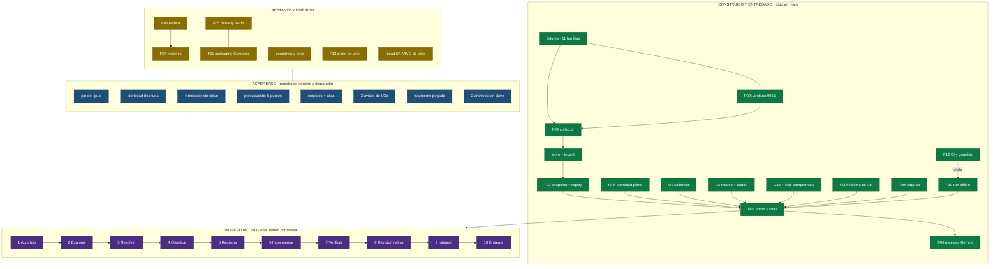

# F1Show - project state map

One page for the question *what exists, what does not, and what is merely carried*. It is a **snapshot**, and it names the revision it was drawn at: `odd/tasks/f1show.md` stays the authority.

**Snapshot:** `5b1e625` (the merge of PR #84): **F14** (wall-clock playback), **F15** (standalone, opt-in speech synthesis), **F06a** (the race tactical motor), **F06b** (the analyst's TACTICAL context), **F06c** (qualifying cutoffs over declared per-season rules) and **F06d** (pit-window projections over declared stint norms) are delivered. The corpus holds **three** recorded sessions — two races and, since F06c, the qualifying `9608`; the full suite and Python 3.12 floor each passed **1124** tests, and CI passed on **3.12 and 3.14** with **Ruff 0.17.0** pinned. The Mermaid diagram below was drawn at `043d2a5` and has not been redrawn since; the tables describe this newer snapshot.

## The map

Exports for readers who cannot render Mermaid: [`project-state.svg`](assets/project-state.svg) (vector) and [`project-state.png`](assets/project-state.png) (raster).

**Reading key.** Green: built and delivered in `main`. Amber: remaining, or deferred on purpose. Blue: **carried** in `docs/CARRIED-FINDINGS.md`, each entry with an owner and a trigger. Purple: the ODD workflow, which runs **one unit per turn**.

## Built and delivered

| Layer | What exists | Why it matters |
| --- | --- | --- |
| Fixtures | **11 families** recorded from the free, unauthenticated OpenF1 API | five event families, the driver directory, the three championship families, sessions and intervals, each with bytes, counts and SHA256 in `fixtures/openf1/PROVENANCE.md` |
| F03 | snapshot, replay and an injected clock | a replay reproduces the transcript byte for byte |
| F04 | the deterministic collector | one record, one event, across the five event families |
| store and ingest | SQLite WAL plus Parquet | keyed by session and driver |
| F09 | the two-person booth | lead and colour, explicit turns, and a citation protocol that admits only supplied references |
| F09b-F09e | the citation surface | every airing shape declared and pinned; the acceptance repaired against **206** measured live calls |
| F09f | driver identity | `driver: Lando NORRIS (McLaren, #4)`, or one declared fallback |
| U1 | the window's salience | biggest gain and loss, the busiest driver, pit stops, flags, and a **derived** fastest lap |
| U2 | the two modes | build and climax, with the priority band revived on the same derived signal |
| U3a | the provisional standings | a declared per-season points dataset, validated against the source's own checkpoints |
| U3b | the championship in the prompt | a bounded per-moment context, with a tied position stated as **tied** |
| F08 | the Gemini gateway | bounds, cost accounting and typed degradation |
| F10 | one command, one process | offline by construction: recorded fixtures, fake providers, injected clock |
| F12 | CI and guards | the lint standard committed with its version pinned, the declared floor enforced, and a register-row guard |
| F09h | the commentary language | Argentine Spanish (`es-AR`) by default, with `es-419`, `es-MX` and `es-ES` selectable and each declaring its address forms and motorsport vocabulary; an omitted language takes the default, an explicit blank is still an error, and the prompt's citation protocol is unchanged |
| F09i | the start aggregation | the twenty lap-1 events air as **one start turn** instead of twenty near-identical ones, with one identity per member citable and every absorbed row recording `covered_by_start` — and, when the group's own turn does not air, mirroring its fate instead of claiming coverage |
| F09j | the second recorded window | session **9655** (the 2024 Qatar Grand Prix) recorded verbatim from the free tier with **no credential**: ten families, **574,894 bytes**, a dated provenance section, and five tests that pin its measured facts; the start rule now has a second, differently-shaped session behind it (zero null timestamps there, where 9617 has an orphan that sorts last) |
| F14 | wall-clock playback | a recorded session is consumed **at the rate it happened** — one wait per event off the run's own earliest known instant, opt-in and injected both-or-neither, with the transcript **byte-identical** to the unpaced run at any scale |
| F15 | speech synthesis, built and opt-in | `f1show.audio` turns a turn's text into audio per seat — declared voice catalogue per dialect, `+10%` rate on climax turns, blank text refused — behind a protocol with a fake; **nothing on the run's path calls it** (zero references in `booth.py` and `run.py`, no test opens a socket) |
| F06a | the race tactical motor, standalone | `f1show.tactical` turns recorded payloads into a total-ordered tuple of source-referenced alerts — gap battles on the `interval` field, lapped readings kept as lap counts, declared unknowns and absences, freshness windows, clean-lap pace deficits against the session best median, and estimated tyre age per current stint — behind configurable, pinned thresholds; **nothing on the run's path calls it** (the booth, `run.py` and the collector are untouched), and it consumes the F04 `classify_gap` handoff, so the orphan deadline is met |
| F06b | the analyst's TACTICAL context, wired | the booth accepts an optional `TacticalSource` and, when `run.py` wires it from the recorded payloads, every turn's prompt carries a per-moment `TACTICAL:` block — the motor read only up to that event's own instant — after CHAMPIONSHIP, under the same context-never-a-source rule (plain prose, no bracket, no reference-shaped token); `intervals` is the loader's one optional family (session 9655 deliberately has none, declared absence), an empty context renders no block, and the source layer bisects build-time-ordered readings so a per-turn context is cheap |
| F06c | qualifying cutoffs, standalone | `f1show.tactical.analyze_qualifying_cutoffs` reads the recorded qualifying `9608` (captured verbatim, 8 families, 340,640 bytes) and the declared per-season rules in `f1show.standings` — 2024 main qualifying: three phases of 18/15/12 minutes with 20/15/10 participants, Sprint Qualifying refused — to report where the elimination line sits and where each driver stands against it: phase windows from `race_control`'s `qualifying_phase` markers with **both** boundary sources shown, the 99 pit-out laps and 22 undated-duration laps **counted** as exclusions, the absent `intervals` family a declared absence, and the live `position` order reported beside the verdict with `position_agrees` — because measured on this session the source's own phase-1 top fifteen contains two drivers who never entered phase 2, so the verdict rests on best-eligible-lap classification; **nothing wires it into the booth or the run path**, and its declared limitations (deleted laps not applied, naive `as_of`, unenforced declared window ends) carry register rows |
| F06d | pit-window projections, standalone | `f1show.tactical.analyze_pit_windows` — the module's **third** pure entry point — refuses a non-Race session through the payloads' own `sessions` family, then projects per driver the stop lap as the current stint's start plus the **declared stint median** under the declared integer rule (**ceiling**: 25.5 → 26, 37.5 → 38 — a tyre is replaced on the following lap, never half a lap earlier), with a window from the declared min–max anchors and every projection labelled an estimate; declared rows (no current lap/stint/compound/norm) keep the readable facts and no projection number; the duration support is a counted fact and **no pit cost is inferred**; a one-lap caution batch is declared as context with its `lap_start >= 2` boundary load-bearing and measured — 9655's two lap-1 openings would otherwise declare a phantom batch; the stint norms live **beside the motor** in `tactical.py` (estimates, not regulation, so not in `standings.py`), **nothing wires it into the booth or the run path**, and its declared limitations carry register rows |

## Remaining, and why

| Item | Why it is not built |
| --- | --- |
| F05 delivery (Redis Streams, fan-out) | deferred on purpose: transport lands after the packaging decision |
| F11 packaging (Docker Compose) | the pair with F05 |
| F06, its remaining tiers (the telemetry source) | F06a (race motor), F06b (booth wiring), F06c (qualifying cutoffs) and F06d (pit-window projections) are delivered — **F06's deterministic tiers are all delivered**; FastF1 is evaluated but **not adopted**, and that decision is what remains |
| F07 historical enrichment | its declared dependency is F01/F05 — F01 is closed, F05 is the deferred pair above — and it shares the FastF1 decision with F06 |
| F13 live pilot | gated on a purchased subscription; zero calls made |
| The **live** half of the citation-form row | needs a live run; the deterministic half is fixed, reviewed and delivered |

## Carried, with an owner and a trigger

Everything below lives in `docs/CARRIED-FINDINGS.md` with its location, owner and trigger. None of it is silent.

- A **supplied** reference used as the right-hand value of `=` is unpinned.
- A second **bare-identity** `EVIDENCE:` line still airs as commentary.
- **Four modules** entered the tree with no staleness key: recorded as a defect in the closure routine rather than four oversights.
- The **budget signal**: five measured points, and size does not explain the gate.
- The **tie order is not derivable**, so the prompt states ties instead of asserting a settled position.
- The priority band's **stale public alias** survives its own refactor.
- **Three advisories** from U3b, with their subjects located in the source because the harness returns no bodies.
- A **bare token glued to a letter** (`position[0][99].evil`) **airs on a field-reference surface**; measured on both the pre-change and the post-change bytes, so it is pre-existing, and closing it would also close the declared tolerance for a bare non-empty bracket — a product trade the module reserves to the user.
- **Two files with no register row and no staleness key at all**: `src/f1show/config.py` and `tests/test_config.py`, named in the register as a gap rather than repaired by ceremony.
- **The second recorded session carries no native review**, and the reason is measured: 575 KB of single-line JSON exceeded the provider's reviewer lens budget, and the split that followed means the review covered the authored part only. It is verified by **measurement** instead — file hashes, counts, the parent's re-derivation and an independent verifier's pass — and the register row says so.
- The **pacing arithmetic** in both provenance sections was wrong as written (`10 requests in 7.4 s` and `8 in 8.481 s` compared against a **per-minute** ceiling read as about 81 and 57); both now state a rate bound and a count bound separately, with the old arithmetic named as wrong.
- The **audio wiring**: `f1show.audio` (F15) is built and opt-in, but no run emits audio — wiring it would put a live network dependency on an offline-by-construction path, which is a product trade. The register row names the owner and the trigger.

## The workflow every unit goes through

1. **Authorize** - read-only until the user authorizes; ambiguous intent gets one question, then a stop.
2. **Explore** - map the seam before writing anything.
3. **Resolve uncertainty** - one research pass, or one focused question.
4. **Classify** - small work stays inline; large work gets a task document.
5. **Register** - the task document, its mirror and the visible list, before the first write.
6. **Implement** - one writer per unit, in its own worktree.
7. **Verify** - an independent read-only check of the delivered bytes.
8. **Review** - the native review; its acknowledgement burns the authority.
9. **Integrate** - the reviewed bytes land in `main`, and the register is re-anchored **by subject**.
10. **Deliver** - issue, push, pull request, CI, merge.

## Regenerating this map

The diagram's source is the fenced block above: render it with any Mermaid renderer. These exports were produced with the Agentic Mermaid MCP. Draw a **new** snapshot rather than editing the picture, and name the revision it describes.
