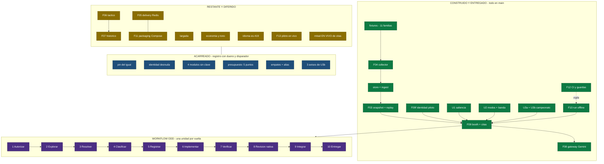

# F1Show - project state map

One page for the question *what exists, what does not, and what is merely carried*. It is a **snapshot**, and it names the revision it was drawn at: `odd/tasks/f1show.md` stays the authority.

**Snapshot:** `c7727f9` (the merge of PR #50), the close of F09g - suite **957 passing** - CI on **3.12 and 3.14** with **Ruff 0.17.0** pinned - **no open pull requests**.

## The map

Exports for readers who cannot render Mermaid: [`project-state.svg`](assets/project-state.svg) (vector) and [`project-state.png`](assets/project-state.png) (raster).

**Reading key.** Green: built and delivered in `main`. Amber: remaining, or deferred on purpose. Blue: **carried** in `docs/CARRIED-FINDINGS.md`, each entry with an owner and a trigger. Purple: the ODD workflow, which runs **one unit per turn**.

## Built and delivered

| Layer | What exists | Why it matters |
| --- | --- | --- |
| Fixtures | **11 families** recorded from the free, unauthenticated OpenF1 API | five event families, the driver directory, the three championship families, sessions and intervals, each with bytes, counts and SHA256 in `fixtures/openf1/PROVENANCE.md` |
| F03 | snapshot, replay and an injected clock | a replay reproduces the transcript byte for byte |
| F04 | the deterministic collector | one record, one event, across the five event families |
| store and ingest | SQLite WAL plus Parquet | keyed by session and driver |
| F09 | the two-person booth | lead and colour, explicit turns, and a citation protocol that admits only supplied references |
| F09b-F09e | the citation surface | every airing shape declared and pinned; the acceptance repaired against **206** measured live calls |
| F09f | driver identity | `driver: Lando NORRIS (McLaren, #4)`, or one declared fallback |
| U1 | the window's salience | biggest gain and loss, the busiest driver, pit stops, flags, and a **derived** fastest lap |
| U2 | the two modes | build and climax, with the priority band revived on the same derived signal |
| U3a | the provisional standings | a declared per-season points dataset, validated against the source's own checkpoints |
| U3b | the championship in the prompt | a bounded per-moment context, with a tied position stated as **tied** |
| F08 | the Gemini gateway | bounds, cost accounting and typed degradation |
| F10 | one command, one process | offline by construction: recorded fixtures, fake providers, injected clock |
| F12 | CI and guards | the lint standard committed with its version pinned, the declared floor enforced, and a register-row guard |

## Remaining, and why

| Item | Why it is not built |
| --- | --- |
| F05 delivery (Redis Streams, fan-out) | deferred on purpose: transport lands after the packaging decision |
| F11 packaging (Docker Compose) | the pair with F05 |
| F06 tactical analysis | precedes F07 |
| F07 historical enrichment | follows F06 |
| Start aggregation | registered design, not authorized |
| Economy and tone | registered design, not authorized |
| Language variant (`es-419`, with `es-AR`, `es-MX` and `es-ES`) | registered design, not authorized |
| F13 live pilot | gated on a purchased subscription; zero calls made |
| The **live** half of the citation-form row | needs a live run; the deterministic half is fixed, reviewed and delivered |

## Carried, with an owner and a trigger

Everything below lives in `docs/CARRIED-FINDINGS.md` with its location, owner and trigger. None of it is silent.

- A **supplied** reference used as the right-hand value of `=` is unpinned.
- A second **bare-identity** `EVIDENCE:` line still airs as commentary.
- **Four modules** entered the tree with no staleness key: recorded as a defect in the closure routine rather than four oversights.
- The **budget signal**: five measured points, and size does not explain the gate.
- The **tie order is not derivable**, so the prompt states ties instead of asserting a settled position.
- The priority band's **stale public alias** survives its own refactor.
- **Three advisories** from U3b, with their subjects located in the source because the harness returns no bodies.

## The workflow every unit goes through

1. **Authorize** - read-only until the user authorizes; ambiguous intent gets one question, then a stop.
2. **Explore** - map the seam before writing anything.
3. **Resolve uncertainty** - one research pass, or one focused question.
4. **Classify** - small work stays inline; large work gets a task document.
5. **Register** - the task document, its mirror and the visible list, before the first write.
6. **Implement** - one writer per unit, in its own worktree.
7. **Verify** - an independent read-only check of the delivered bytes.
8. **Review** - the native review; its acknowledgement burns the authority.
9. **Integrate** - the reviewed bytes land in `main`, and the register is re-anchored **by subject**.
10. **Deliver** - issue, push, pull request, CI, merge.

## Regenerating this map

The diagram's source is the fenced block above: render it with any Mermaid renderer. These exports were produced with the Agentic Mermaid MCP. Draw a **new** snapshot rather than editing the picture, and name the revision it describes.
